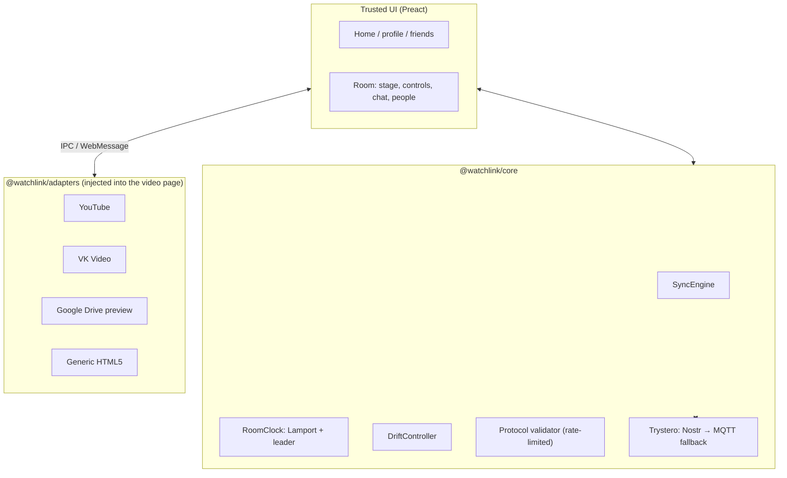

<div align="center">

<picture>
  <source media="(prefers-color-scheme: dark)" srcset="docs/assets/logo-on-dark.svg">
  
</picture>

# WatchLink

**Watch together, peer-to-peer.**<br>No accounts. No servers. No media relay.

Synchronized playback for Linux, Windows and Android.<br>Share a room code, press play, and everyone watches the same moment.

[](LICENSE)
[](#install)
[](https://electronjs.org)
[](https://developer.android.com)
[](https://www.typescriptlang.org)
[](https://preactjs.com)

[Features](#features) · [How it works](#how-it-works) · [Install](#install) · [Development](#development) · [Status](#project-status) · [Privacy](PRIVACY.md) · [Русский](#по-русски)

</div>

---

## Features

- 🔗 **Zero-server rooms.** Peers find each other through public Nostr relays (automatic fallback to MQTT) and talk over encrypted WebRTC data channels. There is no WatchLink backend.
- ▶️ **Direct playback.** Video loads straight from its origin (YouTube, VK Video, Google Drive links, any HTML5 `<video>`). Media is **never** relayed through WatchLink or anyone else.
- 🎯 **Tight sync.** Lamport clocks order actions, a drift controller nudges the playback rate (±5 %) for small offsets and seeks for large ones, and a buffering barrier holds everyone while a peer stalls.
- 🚪 **Late join.** Someone joining mid-movie is aligned to the host automatically.
- 💬 **Chat and people.** Room chat with photo attachments, avatars, a host role you can hand over, and per-peer sync indicators.
- 🎨 **Made for the couch.** Dark, glassy interface; playback controls overlay the video on desktop and phone alike; ambient glow on desktop; English and Russian.
- 🛡️ **Sandboxed content.** Untrusted sites run in an isolated view without Node APIs, with permission requests denied and unsafe navigation blocked.

## How it works



Two views, strictly separated:

- **UI view**: the app itself (`packages/ui`), trusted, talks to the room and to the host shell.
- **Content view**: the video site, untrusted, sandboxed. A small adapter bundle injected at document start reports player state and executes commands. On desktop this is an Electron `WebContentsView` with a frame preload; on Android a second `WebView` with `addDocumentStartJavaScript` and `addWebMessageListener`.

Design decisions and the experiments behind them are recorded in [`docs/decisions.md`](docs/decisions.md).

### Repository layout

```
packages/core        sync engine, clock, drift control, protocol, signaling
packages/adapters    per-site player adapters and the content bridge
packages/ui          Preact interface (shared by desktop and Android)
apps/desktop         Electron shell
apps/android         Kotlin shell (WebViews, foreground service)
packaging/           Arch PKGBUILD, desktop entry
tests/, scripts/     security and e2e tests, verification and capture scripts
docs/                decisions, verification log
```

## Install

Download the files for your system from the [Releases](https://github.com/apvcode/WatchLink/releases) page (Linux AppImage / tar.gz, Windows installer / zip, Android APK), or build from source (see below).

**Windows (x64):** run `watchlink-0.2.2-setup.exe` (per-user installer, no admin rights needed), or unpack `watchlink-0.2.2-win-x64.zip` and start `WatchLink.exe`. The build is unsigned, so SmartScreen shows "Windows protected your PC": choose *More info → Run anyway*.

**Linux (AppImage):**

```bash
chmod +x watchlink-0.2.2.AppImage
./watchlink-0.2.2.AppImage
```

**Arch Linux:** `packaging/arch/PKGBUILD` installs the portable build with a desktop entry and icon.

```bash
cd packaging/arch && makepkg -si
```

**Android:** sideload the APK (`minSdk 26`, `targetSdk 34`):

```bash
adb install -r watchlink-0.2.2.apk
```

Invite links use the `wl://` scheme and open the app directly on Android.

## Development

**Requirements:** Node.js ≥ 20, pnpm ≥ 9, JDK 17 or 21 and the Android SDK (platform 34) for the phone app, ffmpeg for test fixtures.

```bash
pnpm install
bash scripts/doctor.sh      # checks the toolchain
pnpm build                  # core → adapters → ui → desktop
pnpm package:desktop        # Linux: AppImage + tar.gz into dist/
pnpm package:desktop:win    # Windows: NSIS installer + zip into dist/ (works from Linux with wine, or on Windows)
pnpm package:android        # release APK (needs your own keystore)
```

Release signing uses a keystore you provide through `WATCHLINK_KEYSTORE`; keystores, `.env` files and build output are git-ignored.

### Releases

Pushing a tag such as `v0.3.0` starts the [Release workflow](.github/workflows/release.yml): it runs the checks, builds Linux, Windows and Android, and attaches the files and `SHA256SUMS` to the GitHub Release. The Google Drive keys and the Android keystore come from repository secrets (listed at the top of the workflow file); without them the files are only kept as workflow artifacts.

### Checks

```bash
bash scripts/verify.sh      # biome, typecheck, unit tests + coverage, builds, Android unit tests
pnpm test:unit              # vitest with coverage
pnpm test:sim               # simulated long session (drift and jitter)
pnpm test:security          # sandbox and isolation tests
node scripts/live-check.mjs # real Electron against YouTube / VK / Google Drive
```

## Project status

WatchLink is an early development build (0.2.2).

- ✅ Custom player and two-client YouTube playback verified on Linux with a local signaling relay.
- ✅ Late join, quality selection, chat and profiles verified in the desktop app.
- ✅ Windows build (installer and zip) packages successfully; it has not been run on a real Windows machine yet.
- ⚠️ Public-relay signaling and Linux ↔ Android synchronization have not passed acceptance yet.
- 🔜 Google account linking for private Google Drive videos (own file browser, read-only access).

Detailed, dated results live in [`docs/player-verification.md`](docs/player-verification.md).

## Security and privacy

- WebRTC data channels are encrypted by DTLS; the room password protects signaling payloads.
- Content pages get no Node access, no camera/microphone/location permissions, and cannot open windows or download files.
- WatchLink collects no personal data and has no servers. See [PRIVACY.md](PRIVACY.md).

## License

[MIT](LICENSE) © apvcode

---

## По-русски

**WatchLink** — приложение для совместного просмотра видео по P2P для Linux, Windows и Android. Без аккаунтов, без собственных серверов, видео никогда не проходит через посторонние серверы: оно грузится напрямую из источника (YouTube, VK Видео, ссылки Google Диска, любой HTML5-плеер), а состояние воспроизведения синхронизируется между участниками по зашифрованным каналам WebRTC.

Возможности: комнаты по коду и `wl://`-ссылке, точная синхронизация (часы Лампорта, подстройка скорости, барьер буферизации), подключение «на лету», чат с фото, русский и английский интерфейс. Сборка и проверки описаны выше в разделе [Development](#development). Статус проекта: ранняя разработка, приёмка Linux ↔ Android ещё не завершена.
